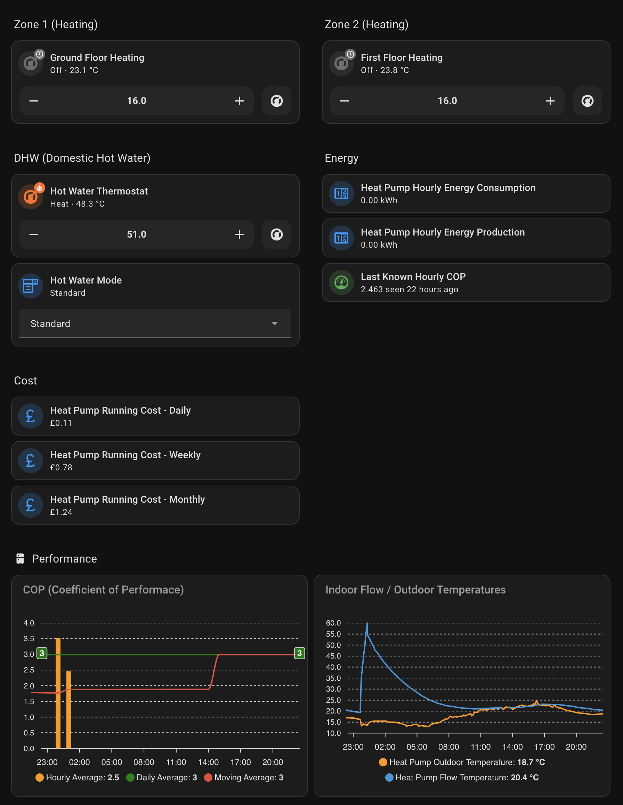

# ESPHome / Home Assistant Samsung Heat Pump Integration

> ⚠️ **Safety Notice**
> 
> Use at your own risk. Write actions (`request_write`, `request_write_as`, `send_structure` with data type write, writable numbers/selects/switches) change settings on the heat pump. Not every message or value is supported by every unit or firmware; only send what you know your unit accepts.

If you find this useful please consider supporting me by buying me a coffee. Thank you!

[](https://www.buymeacoffee.com/jvn5gy8fdy)

This component enables Samsung Heat Pumps to be integrated into ESPHome and Home Assistant. It supports NASA heat pumps that utilize the MIM-E03CN / MIM-E03DN & MIM-E03EN control boards (e.g., Samsung Gen 6 heat pump etc). Older non-NASA systems are not supported. 

The project requires a suitable RS485 Modbus enabled board such as the M5Stack Atomic RS485 Base (https://shop.m5stack.com/products/atomic-rs485-base) with the Atom Lite (https://shop.m5stack.com/products/atom-lite-esp32-development-kit). But any ESPHome supported board with a TTL-RS485 converter should theoretically work. Modbus A connects to F1 and Modubs B connects to F2 on the MIM control board. F1 & F2 are the connectors used for communication betweeen the internal unit/MIM board and the external heat pump unit. F3 & F4 are the connectors used by the wired LCD touch controllers. You can take the 12V V+ from V1 and Ground from V2 on the control board. These pins are normally grouped together on the top right hand side of the control board.

| RS485         | MIM Board Pin |
|---------------|---------------|
|   A  (Yellow) |      F1       |
|   B  (Green)  |      F2       |
|   V+ (Red)    |      V1       |
|   G  (Black)  |      V2       |

This project borrows from the excellent work done by the team supporting the ESPHome Samsung HVAC Integration (https://github.com/omerfaruk-aran/esphome_samsung_hvac_bus/). The project includes detailed [hardware installation instructions](https://github.com/omerfaruk-aran/esphome_samsung_hvac_bus/wiki/Hardware-Installation) on the installation process so I won't repeat them here.

Most of the useful controls for DHW (domestic hot water), and heating (single and 2-zone) are supported by this component - along with the ability to read and write FSVs (Field Setting Values). The project has been re-engineered to abstract away the NASA message codes from the C++ code so it should be much easier to add missing controls to the Python lists of ESPHome components (numbers, selects, switches, sensors etc). This should make it much easier to submit PRs for missing NASA messages.

All commands, and FSVs are implemented as standard ESPHome components (e.g., numbers, selects, switches...). Check out the [example.yaml](example.yaml).

**NB**: When assigning a nasa device to a samsung_nasa platform component make sure you assign the correct indoor/outdoor unit. The easiest way to check is by looking at the NASA Label information in the tables below. If the label says VAR_IN_... or ENUM_IN_... then the status is reported from the indoor unit. If the label says VAR_OUT_..., LVAR_OUT_... or ENUM_OUT..., then the status is reported from the outdoor unit.

## Compilation Using Arduino or ESP-IDF

Using the Arduino framework will result in faster compilation time but less efficient RAM usage and larger firmware size.

```yaml
esp32:
  board: m5stack-atom
  framework:
    type: arduino
```

Using the ESP-IDF framework will result in slower compilation time but smaller firmware size and more efficient RAM usage. From ESPHome 2026.1 onwards the default framework will be esp-idf (unless arduino is specified).

```yaml
esp32:
  board: m5stack-atom
  framework:
    type: esp-idf
```

## Basic Controller, NASA Client & Device Configuration  

```yaml
samsung_nasa:
  debug_log_messages: false
  debug_log_undefined_messages: false
  nasa_client: {}
  devices:
   - address: 20.00.00
     id: nasa_device_1
   - address: 10.00.00
     id: nasa_device_2
```

20.00.00 would normally be the address of the indoor unit; 10.00.00 would be the address of the outdoor unit (heat pump). It's best to leave the nasa_client options empty (at their defaults) as the client has been tested with these default values. You will need to provide an id for each device so you can associate each device with an ESPHome component.

## Advanced Controller, NASA Client & Device Configuration  

```yaml
samsung_nasa:
  debug_log_messages: false
  debug_log_undefined_messages: false
  nasa_client:
    silence_interval: 100
    retry_interval: 500
    min_retries: 1
    send_timeout: 1000
    flow_control_pin: GPIOXX
  devices:
   - address: 20.00.00
     id: nasa_device_1
   - address: 10.00.00
     id: nasa_device_2
```

The nasa_client configuration options are to do with ensuring NASA message delivery via a retry mechansim. Thanks and acknowledgment go to atanasenko for the [retry mechanism.](https://github.com/omerfaruk-aran/esphome_samsung_hvac_bus/commit/1030af3bcc4f3dc688be643e0c2ae65b6401fcc5)

### Addressed reads

```yaml
samsung_nasa:
  addressed_reads: true
```

By default the read after boot is broadcast. Some units do not answer a broadcast read, for example when the unit address was changed (e.g. 20.01.00 after a MIM-B19N Modbus interface was fitted), so all values stay unknown until the unit sends them on its own. With `addressed_reads: true` the read after boot is sent to each configured device address instead, and the read that confirms a write goes to the device that was written to. Like broadcast reads, addressed reads are queued and sent in batches of 10 messages every 200 ms. Without the option nothing changes.

### Source address

```yaml
samsung_nasa:
  source_address: 80.ff.02
```

The component sends its requests from 80.ff.00 by default. If another device on the bus already uses 80.ff.00, both receive each other's answers. With `source_address` the component uses a different address in class 80. Only answers addressed to this address are processed. Tested on an EHS Mono with 80.ff.02: reads and writes on the indoor and outdoor unit were answered and acknowledged, also while another device was sending requests from 80.ff.00 at the same time. Without the option nothing changes.

### Debug output

- `debug_log_messages`: every received value as `Src:… Dst:… 0x4238 = 326 n=1234`, plus the packets of non-notification types.
- `debug_log_undefined_messages`: values the component has no definition for, also with `n=`.
- `debug_log_messages_raw`: the unmodified bytes of every packet (valid and rejected), split into parts of at most 160 bytes so no line is cut off by syslog or the API log:
  `RAW s=2C81A9D1 n=1234 ok len=64 p=1/1 3200402000FF…34`

`n` is a receive number that counts every packet since boot, including rejected ones. It links each value line to its packet and its RAW line, and a gap in `n` shows a lost or rejected packet. `s` is a random session id per boot.

While any of the three options is on, a statistics line is logged once a minute (counters since boot):
`STATS s=2C81A9D1 n=666264 ok=665340 size=66 end=584 crc=274 uart=0`
(`ok` = valid packets, `size` = length out of range, `end` = wrong end byte, `crc` = checksum error, `uart` = UART read errors).
Warnings for rejected packets name the reason and `n`; their bytes are in the RAW lines when `debug_log_messages_raw` is on.

 - **silence_interval**: (Optional) The time to wait since the last wire activity before sending. 
 - **retry_interval**: (Optional) The minimum time before a retry attempt.  
 - **min_retries**: (Optional) The minimum number of retries, even beyond timeout. 
 - **send_timeout**: (Optional) The maximum time to wait before discarding commands.  
 - **flow_control_pin**: (Optional) The pin used to switch flow control. This is useful for RS485 transceivers that do not have automatic flow control switching, like the common MAX485.

## Number  

Commands and FSVs are implemented as number components when they represent a range of values such as temperature, duration etc. For commands use the message option with the NASA hex code; for FSVs use the fsv field:

```yaml
number:
  - platform: samsung_nasa
    message: 0x4201
    name: "Zone 1 Target Temp"
    nasa_device_id: nasa_device_1
    id: zone_target_temp

  - platform: samsung_nasa
    fsv: 2011
    nasa_device_id: nasa_device_1
    name: "Water Law (Outdoor Temp) High"
    id: fsv_2011
```

These are the only fields you need to provide. All other fields such as unit of measure, decimal accuracy etc are automatically configured based on the message or fsv value. Number components are read/write so in the examples above the target temperature can be read and modified; likewise the FSV (Water Law (Outdoor Temp) High) can be modified and the new value sent to the heat pump. Caution needs to be exercised with FSVs. While care has been taken to limit the values to those that are appropriate for the given FSV, there can be minor differences between control boards and permitted min/max values.

### Supported Commands  

| NASA Code | NASA Label                              | Description                            |
|-----------|-----------------------------------------|--------------------------------------- |
| 0x4201    | VAR_IN_TEMP_TARGET_F                    | Zone 1 Target Temperature              |
| 0x42D6    | VAR_IN_TEMP_TARGET_ZONE2_F              | Zone 2 Target Temperature              |
| 0x4235    | VAR_IN_TEMP_WATER_HEATER_TARGET_F       | DHW Target Temperature                 |
| 0x4247    | VAR_IN_TEMP_WATER_OUTLET_TARGET_F       | Zone 1 Water Outlet Target Temperature |
| 0x4248    | VAR_IN_TEMP_WATER_LAW_TARGET_F          | Water Law Target Temperature           |
| 0x42D7    | VAR_IN_TEMP_WATER_OUTLET_TARGET_ZONE2_F | Zone 2 Water Outlet Target Temperature |

### Supported FSVs  

Refer to p.24 onwards of the [MIM-E03EN user manual PDF](MIM-E03EN.pdf).

1011, 1012, 1021, 1022, 1031, 1032, 1041, 1042, 1051, 1052, 2011, 2012, 2021, 2022, 2031, 
2032, 2051, 2052, 2061, 2062, 2071, 2072, 3021, 3022, 3023, 3024, 3025, 3026, 3032, 3033,
3043, 3044, 3045, 3052, 3046, 3081, 3082, 3083, 4012, 4013, 4024, 4025, 4033, 4042, 4043, 
4044, 4045, 4046, 4052, 4053, 5011, 5013, 5014, 5015, 5016, 5017, 5018, 5019, 5021, 5023,
5031, 5032, 5061, 5082, 5083, 5092, 5093

5031 and 5032 are TDM variables (TDM products only); on other units they are reported but have no effect.


You can find a list of supported commands and FSVs in the [python configuration file for number components.](/components/samsung_nasa/nasa/numbers.py)

Behind the scenes ESPHome uses Python scripts to configure platform components. So, for example, here are the python entries for the above number components:

```python
numbers = {
    0x4201: {
        NASA_LABEL: "VAR_IN_TEMP_TARGET_F",
        NASA_MODE: CONTROLLER_MODE_CONTROL,
        CONF_DATA: cmd_numeric_data(16, 30),
        CONF_DEFAULTS: temperature_defaults()
    },
    0x4254: {
        NASA_LABEL: "VAR_IN_FSV_2011",
        NASA_MODE: CONTROLLER_MODE_FSV,
        CONF_DATA: fsv_numeric_data(2011, -20, 5),
        CONF_DEFAULTS: temperature_defaults()
    }
}

```

## Select  

```yaml
select:
  - platform: samsung_nasa
    message: 0x4066
    nasa_device_id: nasa_device_1
    name: Hot Water Mode
    id: hotwater_mode
```

The correct options for select components are automatically configured. You can find a list of supported select components and FSVs in the [python configuration file](/components/samsung_nasa/nasa/selects.py) that is used to auto generate the select component.

So for example message 0x4066 (hot water mode):

```python
0x4066: {
    NASA_LABEL: "ENUM_IN_WATER_HEATER_MODE",
    NASA_MODE: CONTROLLER_MODE_CONTROL,
    CONF_DATA: cmd_select_data(
        [
            "Economy", 
            "Standard", 
            "Power", 
            "Force"
        ]
    ),
    CONF_DEFAULTS: select_defaults()
}
```

### Supported Commands  

| NASA Code | NASA Label                  | Description                                     |
|-----------|-----------------------------|-------------------------------------------------|
| 0x4001    | ENUM_IN_OPERATION_MODE      | Operation mode (eg. Auto, Heat, Cool)           |
| 0x4066    | ENUM_IN_WATER_HEATER_MODE   | DHW mode (eco, standard, power, force)          |
| 0x406F    | ENUM_IN_REFERENCE_EHS_TEMP  | Temperature Reference (Room, Water Out)         |
| 0x8003    | ENUM_OUT_OPERATION_HEATCOOL | Cool/heat mode (Cool, Heat, CoolMain, HeatMain) |

### Supported FSVs  

Refer to p.24 onwards of the [MIM-E03EN user manual PDF](MIM-E03EN.pdf).

2041, 2081, 2091, 2092, 2093, 3011, 3042, 3061, 3071, 4011, 4021, 4022, 4041, 4051, 5042, 5043


## Switch  

Binary type NASA commands and FSV values (such as ON/OFF, YES/NO, ENABLED/DISABLED) are represented as switches. Like Number and Select componentes, they are read/write.

```yaml
switch:
  - platform: samsung_nasa
    message: 0x4065
    nasa_device_id: nasa_device_1
    name: "DHW Power"
    id: dhw_power_switch
  - platform: samsung_nasa
    message: 0x4000
    nasa_device_id: nasa_device_1
    name: "Zone 1 Power"
    id: zone_power
```
 
 A list of available switches can be found in [switches.py](/components/samsung_nasa/nasa/switches.py) which is used to auto configure the switch components.

```python
switches = {
    0x4065: {
        NASA_LABEL: "ENUM_IN_WATER_HEATER_POWER",
        NASA_MODE: CONTROLLER_MODE_CONTROL,
        CONF_DATA: empty_data(),
        CONF_DEFAULTS: bool_defaults()
    },    
    0x4000: {
        NASA_LABEL: "ENUM_IN_OPERATION_POWER",
        NASA_MODE: CONTROLLER_MODE_CONTROL,
        CONF_DATA: empty_data(),
        CONF_DEFAULTS: bool_defaults()
    },
}
```

### Supported Commands  

| NASA Code | NASA Label                           | Description                            |
|-----------|--------------------------------------|----------------------------------------|
| 0x4000    | ENUM_IN_OPERATION_POWER              | Zone 1 heating On/Off control          |
| 0x4046    | ENUM_IN_SILENCE                      | Silence mode  On/Off control           |
| 0x4065    | ENUM_IN_WATER_HEATER_POWER           | DHW On/Off control                     |
| 0x406D    | ENUM_IN_OUTING_MODE                  | Outing On/Off control                  |
| 0x411E    | ENUM_IN_OPERATION_POWER_ZONE2.       | Zone 2 heating On/Off control          |
| 0x4111    | ENUM_IN_OPERATION_AUTOMATIC_CLEANING | Turn on/off automatic cleaning         |

### Supported FSVs  

Refer to p.24 onwards of the [MIM-E03EN user manual PDF](MIM-E03EN.pdf).

3031, 3041, 3051, 4023, 4031, 4032, 4061, 5022, 5041, 5051, 5081, 5091, 5094  

## Text Sensor

Text sensor components are read-only. They monitor internal system states and translate raw NASA protocol values into human-readable text. These are useful for Home Assistant dashboards. If no name field is provided the component will automatically provide a meaningful name

```yaml
text_sensor:
  - platform: samsung_nasa
    message: 0x8001 # Outdoor unit status
    nasa_device_id: nasa_device_2
```

 A list of available text sensors can be found in [text_sensors.py](/components/samsung_nasa/nasa/text_sensors.py) which is used to auto configure the text sensor components.


### Supported Text Sensors

| NASA Code | NASA Label                    | Description                                    |
|-----------|-------------------------------|------------------------------------------------|
| 0x4002    | ENUM_IN_OPERATION_MODE_REAL   | Real-time active mode (e.g., Heat, Cool)       |
| 0x4066    | ENUM_IN_WATER_HEATER_MODE     | DHW mode (Economic, Standard, Power, Force)    |
| 0x4067    | ENUM_IN_3WAY_VALVE            | Water flow diversion (Heating vs DHW Tank)     |
| 0x8000    | ENUM_OUT_OPERATION_SERVICE_OP | Indoor unit defrost operation steps            |
| 0x8001    | ENUM_OUT_OPERATION_ODU_MODE   | Outdoor unit status (Normal, Deice, Vacuum etc)|
| 0x8061    | ENUM_OUT_DEICE_STEP_INDOOR    | Defrost cycle progress (Stage 1, 2, 3 etc)     |
| 0x8235    | VAR_OUT_ERROR_CODE            | Full system diagnostics and error descriptions |

### Translations and Mappings

It is possible to override the default text returned by the text sensor using the optional mapping field. Refer to [text_sensors.py](/components/samsung_nasa/nasa/text_sensors.py) for the possible numeric values returned by the controller.

```yaml
text_sensor:
  - platform: samsung_nasa
    message: 0x4067
    name: "Drei-Wege-Ventil" # Specify your own name for the sensor
    mapping: # <<== Optional mapping field. Specify all or a subset of the mappings
      0: "Heizbetrieb (Raum)"
      1: "Warmwasserspeicher"
```

### Structure messages

Messages of NASA type *structure* (e.g. `0x0600`, `0x0608`, `0x060C`) carry a block of bytes instead of a number. A text
sensor shows them as text if the content is printable, otherwise as hex. Known layouts are formatted automatically
(verified on an EHS Mono) and can be selected with `structure_format` (`hex`, `dbcode`, `dbcode_inverter`, `product_option`). Further verified structures:
`0x061A` product model name and `0x0605` location (text), `0x0607` serial number (text), `0x8601` inverter micom
(`dbcode_inverter`, e.g. `DB91-02411A 100004`):

```yaml
text_sensor:
  - platform: samsung_nasa
    message: 0x0608  # main micom, e.g. "DB91-02103B 231108" (dbcode is the default for 0x0608/0x060C)
    nasa_device_id: samsung_indoor
    name: "Indoor main micom"
  - platform: samsung_nasa
    message: 0x0600  # product option, e.g. "[0]12300-[1]10000-[2]00000-[3]00002"
    nasa_device_id: samsung_indoor
    name: "Product option"
  - platform: samsung_nasa
    message: 0x860D
    nasa_device_id: samsung_outdoor
    name: "Outdoor model information"
    structure_format: hex  # e.g. "08 08 00 12 33"
```

### Large numeric values

Sensor components publish a 32-bit float, which holds integers exactly only up to 2^24 (16,777,216). Larger values
lose their lowest bits: e.g. `0x8404` = 75530754 (`0x04808202`) arrives in Home Assistant as 75530752 (`0x04808200`),
so a change of bit 1 is not visible at all. Energy counters such as `0x8414` or `0x4427` are affected too once they
exceed 2^24. For an exact value use a text sensor (without mapping); `numeric_format: hex` shows the bit pattern:

```yaml
text_sensor:
  - platform: samsung_nasa
    message: 0x8404
    nasa_device_id: samsung_outdoor
    name: "Outdoor 0x8404 exact"  # e.g. "75530754"
  - platform: samsung_nasa
    message: 0x8404
    nasa_device_id: samsung_outdoor
    name: "Outdoor 0x8404 hex"
    numeric_format: hex  # e.g. "0x04808202"
```

## Sensor   

Sensor components are read-only. They report real-time data such as room temperature, energy consumption/production and valve/pump status.

```yaml
sensor:
  - platform: samsung_nasa
    message: 0x4237
    nasa_device_id: nasa_device_1
    name: "DHW Temperature"
    id: hot_water_current_temp
```

In addition to a large selection of available sensors, it is also possible to specify your own NASA code should it not be listed in [sensors.py](/components/samsung_nasa/nasa/sensors.py). You will need to provide the appropriate unit of measure, device class, decimal accuracy and filters to transform the raw NASA value to something meaningful. Consult the [ESPHome documentation](https://esphome.io/components/sensor/) for how to configure a sensor component. As part of the samsung_nasa platform you will need to specify message, nasa_device_id, and platform fields. If you do find a NASA code that is not available as a pre-configured component please pop it in the discussion area along with your yaml configuration for the component so that I can add it for other users.

Here's an example of a user configured sensor:

```yaml
sensor:
   - platform: samsung_nasa
     message: 0x8238
     nasa_device_id: nasa_device_2
     device_class: frequency
     state_class: measurement
     unit_of_measurement: Hz
     accuracy_decimals: 1
     name: Compressor Frequency
     id: compressor_frequency
```

Here is the python entry that configures the above DHW Temperature sensor:

```python
0x4237: {
    NASA_LABEL: "VAR_IN_TEMP_WATER_TANK_F",
    NASA_MODE: CONTROLLER_MODE_STATUS,
    CONF_DEFAULTS: temp_sensor_defaults()
},
```

| NASA Code | NASA Label                                | Description                             |
|-----------|-------------------------------------------|-----------------------------------------|
| 0x24FC    | LVAR_NM_OUT_SENSOR_VOLTAGE                | Heat pump voltage                       |
| 0x4002    | ENUM_IN_OPERATION_MODE_REAL               | Current operation mode                  |
| 0x4038    | ENUM_IN_STATE_HUMIDITY_PERCENT            | Only available with A/C units           |
| 0x4067    | ENUM_IN_3WAY_VALVE                        | DHW valve (0=heat, 1=tank)              |
| 0x4069    | ENUM_IN_THERMOSTAT1                       | Zone 1 input signal from external stat  |
| 0x406A    | ENUM_IN_THERMOSTAT2                       | Zone 2 input signal from external stat  |
| 0x4089    | ENUM_IN_STATE_WATER_PUMP                  | Water pump (0=Off, 1=On)                |
| 0x408A    | ENUM_IN_2WAY_VALVE                        | Zone control valve status               |
| 0x40C4    | ENUM_IN_WATERPUMP_PWM_VALUE               | PWM Water Pump Status (%)               |
| 0x4202    | VAR_IN_DHW_HEAT_UNTIL                     | Heat DHW until this temperature         |
| 0x4204    | VAR_IN_WATER_OUT_TW2                      | Similar to 0x4238 but 2 degrees lower   |
| 0x4205    | VAR_IN_TEMP_EVA_IN_F                      | EVA return temperature                  |
| 0x4206    | VAR_IN_TEMP_EVA_OUT_F                     | EVA flow temperature                    |
| 0x4236    | VAR_IN_TEMP_WATER_IN_F                    | Flow return temperature                 |
| 0x4237    | VAR_IN_TEMP_WATER_TANK_F                  | DHW tank temperature                    |
| 0x4238    | VAR_IN_TEMP_WATER_OUT_F                   | Flow temperature                        |
| 0x4203    | VAR_IN_TEMP_ROOM_F                        | Zone 1 room temperature                 |
| 0x427F    | VAR_IN_TEMP_WATER_LAW_F                   | Water law target flow temperature       |
| 0x42D4    | VAR_IN_TEMP_ZONE2_F                       | Zone 2 room temperature                 |
| 0x42D8    | VAR_IN_TEMP_WATER_OUTLET_ZONE1_F          | Zone 1 water outlet temperature         |
| 0x42D9    | VAR_IN_TEMP_WATER_OUTLET_ZONE2_F          | Zone 2 water outlet temperature         |
| 0x42E8    | VAR_IN_FLOW_SENSOR_VOLTAGE                | Flow sensor voltage                     |
| 0x42E9    | VAR_IN_FLOW_SENSOR_CALC                   | Flow rate sensor (l/min)                |
| 0x4284    | NASA_INDOOR_POWER_CONSUMPTION             | Indoor unit power consumption           |
| 0x4423    | LVAR_IN_MINS_SINCE_INST                   | Mins since installation (unit: days)    |
| 0x4424    | LVAR_IN_MINS_ACTIVE_SINCE_INST            | Mins active since inst. (unit: hours)   |
| 0x4426    | LVAR_IN_4426                              | Heat pump produced energy (last minute) |
| 0x4427    | LVAR_IN_4427                              | Heat pump produced energy (total)       |
| 0x8000    | ENUM_OUT_OPERATION_SERVICE_OP             | Outdoor unit service modes              |
| 0x8001    | ENUM_OUT_OPERATION_ODU_MODE               | Outdoor unit driving Modes              |
| 0x8061    | ENUM_OUT_DEICE_STEP_INDOOR                | Defrost operation steps                 |
| 0x8204    | VAR_OUT_SENSOR_AIROUT                     | Outdoor temperature                     |
| 0x8206    | VAR_OUT_SENSOR_HIGHPRESS                  | High pressure (kPa)                     |
| 0x8208    | VAR_OUT_SENSOR_LOWPRESS                   | Low pressure (kPa)                      |
| 0x820A    | VAR_OUT_SENSOR_DISCHARGE1                 | Compresor discharge temperature         |
| 0x8217    | VAR_OUT_SENSOR_CT1                        | Outdoor current (Amps)                  |
| 0x8218    | VAR_OUT_SENSOR_CONDOUT                    | Heat exchanger outlet temperature       |
| 0x821A    | VAR_OUT_SENSOR_SUCTION                    | Compresor suction temperature           |
| 0x821C    | VAR_OUT_SENSOR_DOUBLETUBE                 | Double tube temperature                 |
| 0x821E    | VAR_OUT_SENSOR_EVIIN                      | EVI return temperature                  |
| 0x8220    | VAR_OUT_SENSOR_EVIOUT                     | EVI flow temperature                    |
| 0x8235    | VAR_OUT_ERROR_CODE                        | Error code (0 = OK)                     |
| 0x8236    | VAR_OUT_CONTROL_ORDER_CFREQ_COMP1         | Compressor instruction frequency        |
| 0x8237    | VAR_OUT_CONTROL_TARGET_CFREQ_COMP1        | Compressor target frequency             |
| 0x8238    | VAR_OUT_CONTROL_CFREQ_COMP1               | Compressor current frequency            |
| 0x823B    | VAR_OUT_SENSOR_DCLINK_VOLTAGE             | Inverter DC voltage input               |
| 0x823D    | VAR_OUT_LOAD_FANRPM1                      | Outdoor fan speed (rpm)                 |
| 0x8240    | NASA_OUTDOOR_ODU_CAPA1                    | Capacity of outdoor unit in kW          |
| 0x8254    | VAR_OUT_SENSOR_IPM1                       | IPM1 sensor reading (°C)                |
| 0x827A    | VAR_OUT_CONTROL_DSH1                      | DSH1 sensor reading (°C)                |
| 0x8280    | VAR_OUT_SENSOR_TOP1                       | TOP1 sensor reading (°C)                |
| 0x829F    | VAR_OUT_SENSOR_SAT_TEMP_HIGH_PRESSURE     | High pressure saturation temperature    |
| 0x82A0    | VAR_OUT_SENSOR_SAT_TEMP_LOW_PRESSURE      | Low pressure saturation temperature     |
| 0x82DF    | VAR_OUT_SENSOR_TW1                        | TW1 sensor reading (°C)(same as 0x4238) |
| 0x82E0    | VAR_OUT_SENSOR_TW2                        | TW2 sensor reading (°C)(same as 0x4236) |
| 0x8411    | NASA_OUTDOOR_CONTROL_WATTMETER_1UNIT      | Outdoor unit inst. power consumed (w)   |
| 0x8413    | LVAR_OUT_CONTROL_WATTMETER_1W_1MIN_SUM    | Heat pump consumed energy (last minute) |
| 0x8414    | LVAR_OUT_CONTROL_WATTMETER_ALL_UNIT_ACCUM | Heat pump consumed energy (total)       |

Bear in mind that VAR_OUT type NASA Labels mean that you will need to assign the outdoor device to the component as it is the external heat pump unit that reports this data.

## Binary Sensor

Binary sensors are read-only. They report boolean type data such as Yes/No, On/Off, Open/Closed.

| NASA Code | NASA Label                        | Description                                |
|-----------|-----------------------------------|--------------------------------------------|
| 0x4028    | ENUM_IN_STATE_THERMO              | Heating Status: 0 = Idle; 1 = Heating      |
| 0x402E    | ENUM_IN_STATE_DEFROST_MODE        | Defrost Status: 0 = Idle; 1 = Defrosting   |
| 0x4067    | ENUM_IN_3WAY_VALVE                | 3-Way Valve: 0 = Heating; 1 = Tank         |
| 0x406C    | ENUM_IN_BACKUP_HEATER             | Backup Heater: 0 = Off; 1 = On             |
| 0x406F    | ENUM_IN_REFERENCE_EHS_TEMP        | Reference Temp: 0 = Room; 1 = Water Out    |
| 0x4087    | ENUM_IN_BOOSTER_HEATER            | Booster Heater: 0 = Off; 1 = On            |
| 0x4089    | ENUM_IN_STATE_WATER_PUMP          | Primary Water Pump Status: 0 = Off; 1 = On |
| 0x8010    | ENUM_OUT_LOAD_COMP1               | Compressor Running: 0 = Off; 1 = On        |
| 0x8017    | ENUM_OUT_LOAD_HOTGAS              | Hot Gas 1 Status: 0 = Off; 1 = On          |
| 0x8019    | ENUM_OUT_LOAD_LIQUID              | Liquid Valve Status: 0 = Off; 1 = On       |
| 0x8021    | ENUM_OUT_LOAD_EVI_BYPASS          | EVI Bypass: 0 = Off; 1 = On                |
| 0x801A    | ENUM_OUT_LOAD_4WAY                | 4-Way Valve Status: 0 = Off; 1 = On        |
| 0x80AF    | ENUM_OUT_LOAD_BASEHEATER          | Base Heater Status: 0 = Off; 1 = On        |
| 0x80D7    | ENUM_OUT_LOAD_PHEHEATER           | PHE Heater Status: 0 = Off; 1 = On         |

```yaml
binary_sensor:
  - platform: samsung_nasa
    message: 0x4087
    nasa_device_id: nasa_device_1
    name: Booster Heater
    id: booster_heater
  - platform: samsung_nasa
    message: 0x8010
    nasa_device_id: nasa_device_2
    name: Compressor Status
    id: compressor_status 
```

Bear in mind that ENUM_OUT type NASA Labels mean that you will need to assign the outdoor device to the component. It is the outdoor (heat pump) unit that reports this data. Like sensors, binary sensors can also be user configured for NASA codes not listed above. See the Sensors section above on how to do this.

## Automations

### Action: samsung_nasa.request_read

Unlike NASA sensors which regularly report data without being requested, FSV values need to be requested. The samsung_nasa.request_read action enables you to request FSV values using ESPHome's powerful automation triggers and conditions. For example you can periodically request readings using ESPHome's interval component:

```yaml
interval:
  - interval: 30min
    startup_delay: 30s
    then:
      - samsung_nasa.request_read:
          id: [fsv_2011, fsv_2012, fsv_2021, fsv_2022]
```

In the above automation FSV values are read 30 seconds after startup and then every 30 minutes (or for example once a day).

By default the read request is broadcast. With `addressed: true` the request is sent directly to the device each component belongs to, in batches of 10 messages per device. The default broadcast behaviour is unchanged.

```yaml
      - samsung_nasa.request_read:
          id: [fsv_2011, fsv_2012]
          addressed: true
```

Alternatively you can implement a configuration button component that when pressed will perform a read request:

```yaml
button:
  - platform: template
    name: Request
    entity_category: config
    on_press:
      - samsung_nasa.request_read:
          id: [fsv_2011, fsv_2012, fsv_2021, fsv_2022]
```

### Action: samsung_nasa.request_write

The vast majority of commands consist of a single NASA "message" being sent to the controller. However, some commands initiated via the Samsung wired controller actually send an ordered sequence of commands under the hood (developers call this a "macro"). In order to mimic this macro behaviour you can use the samsung_nasa.request_write action. This action allows you to specify a list of (switch, number, or select) component ids and their corresponding values. Only samsung_nasa platform switches, numbers and selects can be specified. And the values must be appropriate for the type of component - i.e., true/false for switches, numeric values for numbers, and the [correct string option for selects](components/samsung_nasa/nasa/selects.py).

In the following example we set the domestic hot water mode to economy, target temperature to 51.0 and power to on.

```yaml

select:
  - platform: samsung_nasa
    message: 0x4066
    nasa_device_id: nasa_device_1
    name: Hot Water Mode
    id: dhw_mode

switch:
  - platform: samsung_nasa
    message: 0x4065
    nasa_device_id: nasa_device_1
    name: "DHW Power"
    id: dhw_power

number:
  - platform: samsung_nasa
    message: 0x4235
    nasa_device_id: nasa_device_1
    name: DHW Target Temperature
    id: dhw_target

button:
  - platform: template
    name: DHW Macro
    entity_category: config
    on_press:
      - samsung_nasa.request_write:
          writes:
            - id: dhw_mode
              value: "Economy"
            - id: dhw_target
              value: 51.0
            - id: dhw_power
              value: true
```

You can also expose an action to Home Assistant as a service. In the following example you dynamically set the values at runtime:

```yaml
api:
  services:
    - service: dynamic_dhw_write
      variables:
        dhw_mode: string
        dhw_target: float
        dhw_power: bool
      then:
        - samsung_nasa.request_write:
            writes:
              - id: dhw_mode
                value: !lambda "return dhw_mode;"
              - id: dhw_target
                value: !lambda "return dhw_target;"
              - id: dhw_power
                value: !lambda "return dhw_power;"
```


WARNING: Use this action with caution and only if you know what you are doing!

The same as a lambda: `write(address, message, value)` sends one value as a NASA *Request*, like `samsung_nasa.request_write` does for each entry:

```yaml
      - lambda: id(nasa_controller).write("20.00.00", 0x4065, 1);
```

### Action: samsung_nasa.request_write_as

`samsung_nasa.request_write` always sends a NASA *Request*. Some messages have to be sent with a different data type, e.g. as a *Write*. The samsung_nasa.request_write_as action sends one value with an explicit data type:

- `nasa_device_id` (required): the device to send to.
- `message` (required): the NASA message number.
- `value` (required): the raw value (templatable).
- `data_type` (optional, default `write`): `write` or `request`.

```yaml
button:
  - platform: template
    name: Write example
    on_press:
      - samsung_nasa.request_write_as:
          nasa_device_id: nasa_device_1   # indoor unit 20.00.00
          message: 0x4065
          value: 1
          data_type: write
```

The same as a lambda: `write_as(address, message, value, data_type)` with data type 2 = Write, 3 = Request:

```yaml
      - lambda: id(nasa_controller).write_as("20.00.00", 0x4065, 1, 2);
```

WARNING: Unlike `samsung_nasa.request_write`, this action does not check the value against a component's range or options. Only send messages and data types you know your unit accepts.

### Action: samsung_nasa.send_structure

Some diagnostic data is only sent by the outdoor/indoor unit when it is asked with a *structure* message carrying a fixed payload. The samsung_nasa.send_structure action sends exactly one such message to one device:

- `nasa_device_id` (required): the device to send to.
- `message` (required): the NASA message number, e.g. `0x461E`.
- `data_type` (optional, default `read`): `read` or `write`, as observed on the bus for this message.
- `payload` (optional, default empty): list of bytes, at most 255.

The two requests below were tested on an EHS Mono. The ESP sends from 80.ff.00; do not run it at the same time as another device that uses this address.

```yaml
button:
  # Error history of the indoor unit (STR_IN_ERROR_HISTORY_FOR_HASS). NASA Read, answer: 46 bytes.
  # Never send 0x40D6 (ENUM_IN_ERROR_HISTORY_CLEAR_FOR_HASS), it clears the history.
  - platform: template
    name: Read error history 0x461E
    entity_category: diagnostic
    on_press:
      - samsung_nasa.send_structure:
          nasa_device_id: nasa_device_1   # indoor unit 20.00.00
          message: 0x461E
          data_type: read
          payload: [0x00, 0x00, 0x00, 0x00, 0x00]
  # Cycle data before the last error of the outdoor unit.
  # Sent as data type Write with payload 00 01 00 00 00 00; it only starts the dump.
  # Do not press it repeatedly: the dump is about 390 packets and occupies the bus for ~40 s.
  - platform: template
    name: Read cycle data before error 0x860B
    entity_category: diagnostic
    on_press:
      - samsung_nasa.send_structure:
          nasa_device_id: nasa_device_2   # outdoor unit 10.00.00
          message: 0x860B
          data_type: write
          payload: [0x00, 0x01, 0x00, 0x00, 0x00, 0x00]
```

The same is available from lambdas as `id(nasa_controller).send_structure("20.00.00", 0x461E, 1, {0, 0, 0, 0, 0});` (data type 1 = Read, 2 = Write).

WARNING: `send_structure` sends whatever you give it. Only send the messages documented here.

#### Reading device information

The structure messages listed under [Structure messages](#structure-messages) are not sent on their own; they arrive only when a device on the bus asks for them. A read with 10 zero bytes is answered with the content (tested on an EHS Mono, all as data type `read`):

| Device | Message | Content |
|---|---|---|
| indoor 20.00.00 | 0x0600, 0x0601, 0x0602, 0x0603 | product option / installation options |
| indoor 20.00.00 | 0x0605 | location (empty if not set) |
| indoor 20.00.00 | 0x0607 | serial number |
| indoor 20.00.00 | 0x0608 | main micom |
| outdoor 10.00.00 | 0x061A | product model name |
| outdoor 10.00.00 | 0x0605 | location |
| outdoor 10.00.00 | 0x0607 | serial number |
| outdoor 10.00.00 | 0x0608, 0x060C | main micom, EEPROM |
| outdoor 10.00.00 | 0x8601 | inverter micom |
| Wi-Fi kit 62.00.91 | 0x061C | MAC address (payload: 1 zero byte; also answered as a broadcast read) |

```yaml
script:
  - id: read_device_info
    mode: single
    then:
      - samsung_nasa.send_structure:
          nasa_device_id: nasa_device_2   # outdoor unit 10.00.00
          message: 0x061A
          data_type: read
          payload: [0x00, 0x00, 0x00, 0x00, 0x00, 0x00, 0x00, 0x00, 0x00, 0x00]
      - delay: 1500ms
      - samsung_nasa.send_structure:
          nasa_device_id: nasa_device_1   # indoor unit 20.00.00
          message: 0x0607
          data_type: read
          payload: [0x00, 0x00, 0x00, 0x00, 0x00, 0x00, 0x00, 0x00, 0x00, 0x00]
      # ... one block per message from the table, 1.5 s apart
```

These values only change when a unit is replaced or updated, which means the bus is powered off and the ESP restarts anyway, so reading them once after boot is enough.

#### Reading the error history when the error code changes

Instead of reading 0x461E on a schedule, read it whenever the error code (0x8235) changes:

```yaml
sensor:
  - platform: samsung_nasa
    message: 0x8235
    nasa_device_id: nasa_device_2
    name: Error code
    on_value:
      then:
        - delay: 5s
        - samsung_nasa.send_structure:
            nasa_device_id: nasa_device_1
            message: 0x461E
            data_type: read
            payload: [0x00, 0x00, 0x00, 0x00, 0x00]
```

#### 0x860B layout

The outdoor unit answers with 30 records, one per minute, covering the 30 minutes up to the error; the last record is the error itself. Each record is 13 notification packets with one 0x860B structure each. Structure payload: `00 01`, record number (0–29), `1D` (= last record number), packet number (0–12), then the data bytes listed below (byte 0 is always `0C`). The dump was still present after the error had been reset. Only packets 0, 1 and 4 carried data on a single-compressor monobloc.

*Compared* means checked value by value over all 30 records; *read off* means only checked for plausibility.

| Packet | Byte | Length | Field | Scale | Check |
|---|---|---|---|---|---|
| 0 | 1 | 2 (LE) | Time, seconds since first record | 1 | compared |
| 0 | 3 | 1 | O/U Total Capacity | 1 | read off |
| 0 | 5 | 2 (LE) | Error Code | 1 | compared |
| 0 | 7 | 1 | error unit | 1 | compared |
| 0 | 8 | 1 | Cool/Heat (2 = Heat) | – | read off |
| 0 | 9 | 1 | Operation Mode (2 = Normal, 7 = Prohibit) | – | read off |
| 0 | 10 | 1 | Capacity | 1 | compared |
| 0 | 11 | 1 | HP | 1 | compared |
| 0 | 12 | 1 | Total Comp | 1 | read off |
| 0 | 13 | 1 | Outdoor Fan Step | ×10 | compared |
| 0 | 14 / 15 / 16 | 1 each | Target / Order / Current Frequency1 (Hz) | 1 | compared |
| 0 | 23 | 1 | High Pressure | ÷10 | compared |
| 0 | 25 | 1 | Low Pressure | ÷10 | compared |
| 0 | 27 | 1 | Discharge1 (°C) | 1 | compared |
| 0 | 30 | 1 | Comp Top1 (°C) | 1 | compared |
| 0 | 33 | 1 | Compressor Current1 (A) | 1 | compared |
| 0 | 36 | 1 | IPM1 (°C) | 1 | compared |
| 0 | 39 | 1 | Outdoor Temp. (°C) | 1 | compared |
| 0 | 40 | 1 | CondOut Temp. (°C) | 1 | compared |
| 1 | 2 | 1 | Suction1 Temp. (°C) | 1 | compared |
| 1 | 3 / 4 | 1 each | EVI IN / EVI OUT (°C) | 1 | compared |
| 1 | 5 | 1 | Main EEV1 (steps) | ×10 | compared |
| 1 | 6 / 7 | 1 each | EVI EEV / EVI SOL EEV | ×10? | only 0 seen |
| 1 | 9 | 1 | bit 1 = Comp1 on | – | read off |
| 4 | 25–28 | 1 each | Indoor: Set Temperature, Eva In1, Tw1, Tw2 (°C) | 1 | read off |

Bytes not listed were 0 or constant; the second compressor and unused unit blocks are not part of this table. 0x461E returned 46 zero bytes in every read so far (also after errors), so its layout is unknown.

#### 0x860B request modes

Byte 1 of the 0x860B request payload (`00 <mode> 00 00 00 00`, data type `write`, sent to the outdoor unit) selects which record the outdoor unit sends. All answers use the same framing: byte 1 echoes the mode, bytes 2/3 are the record (or first slot) / last one, bytes 4/5 the packet / last packet, data from byte 6.

| Mode | Content | Answer | Tested |
|---|---|---|---|
| 1 | Cycle data before the last error (layout above) | 30 records × 13 packets | yes, data |
| 2 | Test run cycle data | 60 records × 13 packets | yes, empty (no test run stored) |
| 3 | Error code history | 16 packets, 200 entries | yes, data (see below) |
| 4 | Key input data | 5 packets, 200 bytes | yes, empty (all `FF`) |
| 5 | Appears to reset a counter | – | **not tested, do not send** |
| 6 | Refrigerant cycle data | 6 records × 13 packets | yes, empty (all `FF`) |

The stored data survives an error reset and power cuts. Communication errors (E201/E202) did not replace the stored cycle data in testing.

#### Error code history (0x860B mode 3)

```yaml
button:
  - platform: template
    name: Read outdoor error code history 0x860B
    entity_category: diagnostic
    on_press:
      - samsung_nasa.send_structure:
          nasa_device_id: nasa_device_2   # outdoor unit 10.00.00
          message: 0x860B
          data_type: write
          payload: [0x00, 0x03, 0x00, 0x00, 0x00, 0x00]
```

The outdoor unit answers with 16 notification packets. Structure payload: `00 03`, first slot of this packet (`00`, `0D`, `1A`, … in steps of 13), `C7` (= last slot 199), `00 00`, then up to 13 entries of 3 bytes:

| Byte | Content |
|---|---|
| 0 | error unit: `C8` (200) = outdoor unit, `00` = indoor/hydro unit codes |
| 1 | error code, low byte |
| 2 | error code, high byte (E438 = `B6 01`) |

`FF FF FF` marks an empty slot. The buffer holds 200 entries, oldest first, without timestamps; new entries are appended at the end. In testing, the most recent entries matched the known order of errors. The error unit value 200 matches the "error unit" column of the cycle data (packet 0, byte 7).

## Climate Component

The samsung_nasa platform extends to the climate component which can report current DHW (domestic hot water) temperature and room temperature if you use the Samsung wired controller as a thermostat. For DHW and heating you can control the target temperature and even bind select components to auto generate presets.

```yaml
climate:
  - platform: samsung_nasa
    name: Hot Water
    id: climate_hot_water
    power_switch_id: dhw_power_switch
    current_temp_sensor_id: hot_water_current_temp
    target_temp_number_id: hot_water_target_temp
    custom_preset_select_id: hotwater_mode
    action_mode_sensor:
      id: three_way_valve
      mappings:
        0: CLIMATE_ACTION_IDLE
        1: CLIMATE_ACTION_HEATING
    visual:
      min_temperature: 30
      max_temperature: 60
      temperature_step:
        target_temperature: 0.5
        current_temperature: 0.1
```

In the above example the climate control can report/control heat/off mode by binding the power_switch_id field to the appropriate switch component:

```yaml
switch:
  - platform: samsung_nasa
    message: 0x4065
    nasa_device_id: nasa_device_1
    name: "DHW Power"
    id: dhw_power_switch
```

The climate component reports hot water temperature by binding the current_temp_sensor_id to the appropriate sensor component:

```yaml
sensor:
  - platform: samsung_nasa
    message: 0x4237
    nasa_device_id: nasa_device_1
    name: "DHW Temperature"
    internal: true
    id: hot_water_current_temp
```

Likewise, target temperature can be bound to a number component for reading/modifying the desired temperature:

```yaml
number:
  - platform: samsung_nasa
    message: 0x4235
    name: DHW Target Temperature
    nasa_device_id: nasa_device_1
    id: hot_water_target_temp
```
If you are feeling adventurous you can even have the climate component report current action of the heat pump (idle, heating, off etc) by binding the action_mode_sensor field to the appropriate pump or valve. In the above example NASA code 0x4067 is the code for reporting the DHW valve status (0 = room; 1 = hot water tank). When this sensor reports a value of 1 the heat pump is actively heating the hot water tank.

```yaml
sensor:
    # 0x4067
    # 0 = room; 1 = tank
  - platform: samsung_nasa
    message: 0x4067
    nasa_device_id: nasa_device_1
    name: "3-Way Valve"
    id: three_way_valve 

climate:
  - platform: samsung_nasa
    name: Hot Water
    id: climate_hot_water
    power_switch_id: dhw_power_switch
    current_temp_sensor_id: hot_water_current_temp
    target_temp_number_id: hot_water_target_temp
    custom_preset_select_id: hotwater_mode
    action_mode_sensor:
      id: three_way_valve
      mappings:
        0: CLIMATE_ACTION_IDLE
        1: CLIMATE_ACTION_HEATING
```

Use the mappings field to map sensor values to climate action modes. Available climate action modes are:

* CLIMATE_ACTION_OFF  
* CLIMATE_ACTION_COOLING  
* CLIMATE_ACTION_HEATING  
* CLIMATE_ACTION_IDLE  

Finally you populate the climate component's presets from a select component. In this example the NASA code 0x4066, which is implemented as a select component, is bound to the climate's custom_preset_select_id field.

```yaml
select:
  - platform: samsung_nasa
    message: 0x4066
    nasa_device_id: nasa_device_1
    name: Hot Water Mode
    id: hotwater_mode
```

## Advanced Climate Component: Climate Modes

In most cases the default behaviour of the samsung_nasa framework climate component suffices, i.e, simply turn the heating zone or hot water on (heat) or off. However, advanced users also have the ability to specify climate modes. This is done by specifying two additional fields. Firstly, you can explicitly link the climate component to the 0x4001 select component (operation/climate mode). The options available with 0x4001 are: "Heat", "Cool", "Auto", "Dry" and "Fan". Secondly, not all of these modes may be required so you can use the supported_modes field to show only the modes your specific indoor unit or zone uses (i.e., hiding the "Cool" mode).

```yaml
climate:
  - platform: samsung_nasa
    name: "Zone 1"
    # The power switch (Register 0x4000)
    power_switch_id: nasa_power_switch     
    # NEW: The mode select (Register 0x4001)
    # Linking this allows ESPHome to force the mode when turning on
    mode_select_id: nasa_mode_select    
    # NEW: UI Filtering
    # Only these options will appear in Home Assistant
    supported_modes:                   
      - HEAT
      - COOL
```
Available options for supported_modes:

| YAML Value  | ESPHome Enum Constant    | NASA Register (0x4001) Mapping      |
| :---        | :---                     | :---                                |
| `OFF`       | `CLIMATE_MODE_OFF`       | Handled via Power Register (0x4000) |
| `HEAT`      | `CLIMATE_MODE_HEAT`      | Maps to the string `"Heat"`         |
| `COOL`      | `CLIMATE_MODE_COOL`      | Maps to the string `"Cool"`         |
| `HEAT_COOL` | `CLIMATE_MODE_HEAT_COOL` | Maps to the string `"Auto"`         |
| `DRY`       | `CLIMATE_MODE_DRY`       | Maps to the string `"Dry"`          |
| `FAN_ONLY`  | `CLIMATE_MODE_FAN_ONLY`  | Maps to the string `"Fan"`          |

### Logic Flow

In this scenario the climate component now manages the relationship between the Power Switch and the Mode Select register to ensure they never get out of sync.

1. Commanding: When you select "Cool" in Home Assistant, the component first ensures the NASA Power register is ON, then sends the "Cool" command to the NASA Mode register.

2. Memory: If the unit is turned off via the NASA framework, the ESPHome component "bookmarks" the current mode.

3. Restore: On a "Power On" command, it re-issues the bookmarked mode to the 0x4001 register, ensuring the unit doesn't default to an unwanted state (like Fan Only).

## What if My System Uses 3rd Party Thermostats?

Whilst you won't be able to use the samsung_nasa platform climate control you can still turn the heating zone on/off and report whether or not 3rd party thermostats are calling for heat. Note that when your heat pump is configured to use 3rd party thermostats to control heating zone valves (rather than the Samsung wired controller acting as thermostat with zone control enabled) the MIM control board will not use pins B9/B10, B13/B14 (switched live output for zone valve control). Instead try something like this:

```yaml
switch:
  # Turn Heating Zone On/Off
  - platform: samsung_nasa
    message: 0x4000
    nasa_device_id: nasa_device_1
    name: "Zone Power"
binary_sensor:
  - platform: template
    name: "Zone Running"
    id: heating_running
text_sensor:
  - platform: template
    name: "Zone Action"
    id: heating_action
sensor:
    # 0x4069: ENUM_IN_THERMOSTAT1
    # On MIM control board 3rd party thermostats 
    # are connected to Pin B22 which is a command 
    # signal input (Command Signal Zone 1 Heating)
    # 0 = Off, 1 = Cool, 2 = Heat
    # If Off then Action = Idle
    # If Heat then Action = Heating
  - platform: samsung_nasa
    id: zone_heating
    message: 0x4069
    nasa_device_id: nasa_device_1
    state_class: measurement
    on_value:
        then:
            - if:
                condition:
                    lambda: "return x == 0;"
                then:
                    - binary_sensor.template.publish:
                        id: heating_running
                        state: OFF
                    - text_sensor.template.publish:
                        id: heating_action
                        state: "Idle"
                else:
                    - binary_sensor.template.publish:
                        id: heating_running
                        state: ON
                    - text_sensor.template.publish:
                        id: heating_action
                        state: "Heating"
```

## COP (Coefficient of Performance)

The COP of a heat pump is a measure of its efficiency, specifically how much heat it can produce for a given amount of electricial energy input. A higher COP indicates a more efficient heat pump. For example, if a heat pump has a COP of 3, it means that for every 1 unit of electrical energy it consumes, it delivers 3 units of heat.

**Accuracy:** the examples below use the unit's own values. These are partly calculated rather than measured (internal sensors and settings made during installation) and do not cover everything, e.g. circulation pumps or a backup heater on a separate supply. For reliable values use a real electricity meter and ideally a heat meter. The examples are a starting point for a single-zone unit and need adapting to other installations (booster or backup heater, several zones, extra pumps, external meters).

Using sensors 0x8414 (total consumed energy) and 0x4427 (total produced energy) it is possible to do a crude calculation of the overall COP of your heat pump:

```yaml
# Assuming the 0x8414 sensor has an id of heat_pump_cumulative_energy
# Assuming the 0x4427 sensor has an id of heat_pump_produced_energy
sensor:
  - platform: template
    name: COP - Total
    icon: mdi:chart-bar
    lambda: |-
      return id(heat_pump_produced_energy).state /
             id(heat_pump_cumulative_energy).state;
    update_interval: 300s
    accuracy_decimals: 2
```

### Current COP

Heat output (0x4426) and power input (0x8413) arrive about once per minute and at different times. Dividing whatever values are current at a fixed interval mixes an old value with a new one, so the result jumps. Calculating only when both values have been refreshed since the last calculation keeps the COP current without the jumps:

```yaml
# Assuming 0x4426 has id heat_output, 0x8413 has id power_input and the compressor frequency (0x8238) has id comp_freq
globals:
  - id: cop_heat_fresh
    type: bool
    initial_value: 'false'
  - id: cop_power_fresh
    type: bool
    initial_value: 'false'

script:
  - id: cop_pair
    then:
      - lambda: |-
          if (!id(cop_heat_fresh) || !id(cop_power_fresh)) return;
          id(cop_heat_fresh) = false;
          id(cop_power_fresh) = false;
          float out = id(heat_output).get_raw_state();
          float in = id(power_input).get_raw_state();
          float hz = id(comp_freq).state;
          // no COP while the compressor is off or the power input is too small to be meaningful
          if (!std::isfinite(hz) || hz <= 0 || !std::isfinite(out) || !std::isfinite(in) || in < 100) {
            id(cop_current).publish_state(NAN);
            return;
          }
          id(cop_current).publish_state(out / in);

sensor:
  - platform: samsung_nasa
    message: 0x4426
    id: heat_output
    # ...
    on_raw_value:
      then:
        - lambda: 'id(cop_heat_fresh) = true;'
        - script.execute: cop_pair
  - platform: samsung_nasa
    message: 0x8413
    id: power_input
    # ...
    on_raw_value:
      then:
        - lambda: 'id(cop_power_fresh) = true;'
        - script.execute: cop_pair
  - platform: template
    name: COP - Current
    id: cop_current
    state_class: measurement
    accuracy_decimals: 2
    update_interval: never
```

### Energy, runtime and starts per operating mode

A COP over a day or a week is best calculated from the cumulative counters (0x4427 heat generated, 0x8414 energy consumed) as Δheat / Δenergy. Splitting the energy by operating mode matters, because domestic hot water runs at a higher flow temperature and a mixed COP says little about either mode.

The header below assigns each increase of the counters to space heating, DHW, idle or unknown, based on the compressor frequency and the 3-way valve (0x4067). An increase that spans a change of mode is split by time. Defrost is counted in the mode it happens in and additionally on its own. Everything lives in RAM: after a reboot the counters start at 0 again, and Home Assistant continues them because they are `total_increasing`. Only the energy during the time the ESP is offline is not assigned.

Save as `cop_split.h` next to your YAML:

```cpp
#pragma once
#include <cstdint>

namespace cop_split {

enum Mode : uint8_t { HEATING = 0, DHW = 1, IDLE = 2, UNKNOWN = 3, MODES = 4 };

struct Counter {
  bool has_value = false;
  float last = 0;
  double time_ms[MODES] = {0};  // time per mode since the last counter value
  double defrost_ms = 0;
  double kwh[MODES] = {0};
  double defrost_kwh = 0;
};

struct State {
  Mode mode = UNKNOWN;
  bool defrost = false;
  bool has_time = false;
  uint32_t since_ms = 0;
  Counter counter[2];  // 0 = heat, 1 = energy
  double run_ms[MODES] = {0};
  double defrost_run_ms = 0;
  uint32_t starts[MODES] = {0};
};

inline State &state() {
  static State s;
  return s;
}

inline Mode mode_of(bool hz_valid, float hz, bool valve_valid, bool valve_dhw) {
  if (!hz_valid) return UNKNOWN;
  if (hz <= 0) return IDLE;
  if (!valve_valid) return UNKNOWN;
  return valve_dhw ? DHW : HEATING;
}

// credit the elapsed time to the previous mode, then switch to the new one
inline void update(uint32_t now_ms, Mode mode, bool defrost) {
  State &s = state();
  defrost = defrost && (mode == HEATING || mode == DHW);
  if (s.has_time) {
    double dt = (double) (uint32_t) (now_ms - s.since_ms);
    s.run_ms[s.mode] += dt;
    if (s.defrost) s.defrost_run_ms += dt;
    for (auto &c : s.counter) {
      c.time_ms[s.mode] += dt;
      if (s.defrost) c.defrost_ms += dt;
    }
    if (s.mode == IDLE && (mode == HEATING || mode == DHW)) s.starts[mode]++;
  }
  s.mode = mode;
  s.defrost = defrost;
  s.since_ms = now_ms;
  s.has_time = true;
}

inline void reset_time(Counter &c) {
  for (auto &t : c.time_ms) t = 0;
  c.defrost_ms = 0;
}

// new counter value in kWh
inline void counter_value(int nr, float value, uint32_t now_ms) {
  State &s = state();
  update(now_ms, s.mode, s.defrost);
  Counter &c = s.counter[nr];
  if (!(value > 0)) return;
  if (!c.has_value) {  // first value after boot: baseline only
    c.has_value = true;
    c.last = value;
    reset_time(c);
    return;
  }
  double delta = (double) value - (double) c.last;
  if (delta == 0) return;
  double total_ms = 0;
  for (double t : c.time_ms) total_ms += t;
  // counter went back or jumped (more than 30 kW over the elapsed time): new baseline, nothing assigned
  if (delta < 0 || delta > 30.0 * total_ms / 3.6e6 + 0.05) {
    if (delta < 0 && delta > -0.05) return;
    c.last = value;
    reset_time(c);
    return;
  }
  if (total_ms <= 0) {
    c.kwh[s.mode] += delta;
    if (s.defrost) c.defrost_kwh += delta;
  } else {
    for (int m = 0; m < MODES; m++) c.kwh[m] += delta * c.time_ms[m] / total_ms;
    c.defrost_kwh += delta * c.defrost_ms / total_ms;
  }
  c.last = value;
  reset_time(c);
}

inline float kwh(int nr, Mode m) { return (float) state().counter[nr].kwh[m]; }
inline float defrost_kwh(int nr) { return (float) state().counter[nr].defrost_kwh; }
inline float hours(Mode m) { return (float) (state().run_ms[m] / 3.6e6); }
inline float defrost_hours() { return (float) (state().defrost_run_ms / 3.6e6); }
inline float starts(Mode m) { return (float) state().starts[m]; }

}  // namespace cop_split
```

And in the YAML (ids as above, plus `heat_total` for 0x4427, `energy_total` for 0x8414, `valve_dhw` for the binary sensor 0x4067 and `defrost` for 0x402E):

```yaml
esphome:
  includes:
    - cop_split.h

script:
  - id: cop_mode
    then:
      - lambda: |-
          auto mode = cop_split::mode_of(id(comp_freq).has_state() && std::isfinite(id(comp_freq).state),
                                         id(comp_freq).state, id(valve_dhw).has_state(), id(valve_dhw).state);
          cop_split::update(millis(), mode, id(defrost).has_state() && id(defrost).state);
      - script.execute: cop_publish
  - id: cop_publish
    then:
      - lambda: |-
          using namespace cop_split;
          id(heat_heating).publish_state(kwh(0, HEATING));
          id(heat_dhw).publish_state(kwh(0, DHW));
          id(energy_heating).publish_state(kwh(1, HEATING));
          id(energy_dhw).publish_state(kwh(1, DHW));
          id(energy_idle).publish_state(kwh(1, IDLE));
          id(energy_defrost).publish_state(defrost_kwh(1));
          id(runtime_heating).publish_state(hours(HEATING));
          id(runtime_dhw).publish_state(hours(DHW));
          id(starts_heating).publish_state(starts(HEATING));
          id(starts_dhw).publish_state(starts(DHW));

sensor:
  - platform: samsung_nasa
    message: 0x8238
    id: comp_freq
    # ...
    on_raw_value:  # every frame, so the mode is known soon after boot
      then:
        - script.execute: cop_mode
  - platform: samsung_nasa
    message: 0x4427
    id: heat_total
    # ...
    on_value:  # after the library filter (kWh)
      then:
        - script.execute: cop_mode
        - lambda: 'cop_split::counter_value(0, x, millis());'
        - script.execute: cop_publish
  - platform: samsung_nasa
    message: 0x8414
    id: energy_total
    # ...
    on_value:
      then:
        - script.execute: cop_mode
        - lambda: 'cop_split::counter_value(1, x, millis());'
        - script.execute: cop_publish
  # one template sensor per value, for example:
  - platform: template
    name: Heat - Heating
    id: heat_heating
    unit_of_measurement: kWh
    device_class: energy
    state_class: total_increasing
    accuracy_decimals: 3
    update_interval: never
  # ... heat_dhw, energy_heating, energy_dhw, energy_idle, energy_defrost (kWh),
  # runtime_heating, runtime_dhw (h, device_class duration), starts_heating, starts_dhw (no unit)

binary_sensor:
  - platform: samsung_nasa
    message: 0x4067
    id: valve_dhw
    # ...
    on_state:
      then:
        - script.execute: cop_mode
  - platform: samsung_nasa
    message: 0x402E
    id: defrost
    # ...
    on_state:
      then:
        - script.execute: cop_mode
```

Daily or weekly values are easiest in Home Assistant, which keeps them across ESP reboots, e.g. with a `utility_meter` per sensor and a template sensor `COP heating today = heat heating today / energy heating today`.

Thanks to [@mergwyn](https://github.com/mergwyn) for providing these examples.

## Home Assistant

An example heat pump dashboard in Home Assistant using this component and the example.yaml.



## Implementation Details

On startup the NASA Controller issues a read request for all configured samsung_nasa platform components. These are batched into groups of up to 10 messages and dispatched with a small time delay between each read request. The heat pump responds with a value for each NASA message so all samsung_nasa components should have an initial up-to-date value (including FSVs).

When a command is issued and successfully actioned by the heat pump, the heat pump responds with an ACK message. A read request is then issued to confirm the new value and this is reported back to the samsung_nasa platform components. Components therefore do not require optimistic: true to be set as feedback from the NASA Controller component updates the state of the component soon after the command has been issued.

A batched dispatcher is used for outgoing read requests - this automatically combines up to 10 read requests into a single payload and these batches are issued with a small delay betweeen each dispatch as a means of congestion control. Read requests beyond the queue limit of 100 (e.g. the read after boot of a large configuration) wait in a backlog and are sent as the queue empties, so none are lost. There is also an outgoing queue which writes to the bus when the bus is "quiet" i.e. not currently receiving data. These two approaches combined together should hopefully minimise traffic and help reduce collisions.

## NASA Protocol & List of Codes

The protocol and list of codes are available [here](samsung_nasa_protocol.md) courtesy of [@larrykluger](https://github.com/larrykluger).

## Acknowledgments

@Ianwin for founding the samsung HVAC Bus project; 
@omerfaruk-aran for maintaining the samsung HVAC project; @north3221, @matthias882, @hnykda, @Foxhill67 for technical contributions to understanding the NASA protocol. Thanks goes to @atanasenko for the much improved retry-mechanism.
